# Evidencias del Taller 8

**Taller:** Especificación, modelo de datos y actividades del curso.
**Repositorio:** https://github.com/juansebastianesper-ai/plataforma-ludica
**Aplicación publicada:** https://plataforma-ludica.onrender.com
**Curso:** Lógica y programación.
**Mecánica:** Niveles.
**Aprendiz:** Juan Sebastian Esper Martinez.

El curso y la mecánica coinciden con `app/proyecto.py`. Las capturas de GitHub y Render son públicas y muestran el usuario `juansebastianesper-ai` o la dirección del repositorio. No se capturó la pestaña Environment de Render ni se incluyen secretos.

## 1. Datos iniciales

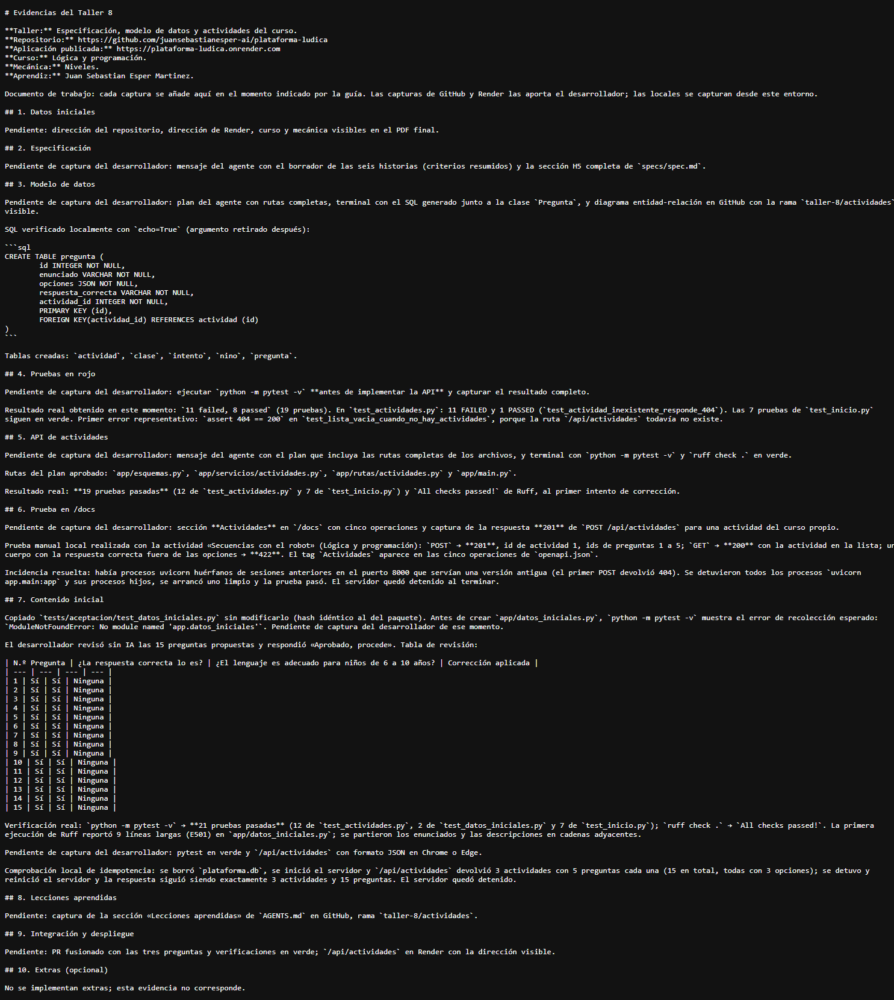

Explicación: al inicio del documento quedan escritos el repositorio, la dirección de Render, el curso Lógica y programación y la mecánica Niveles.

## 2. Especificación

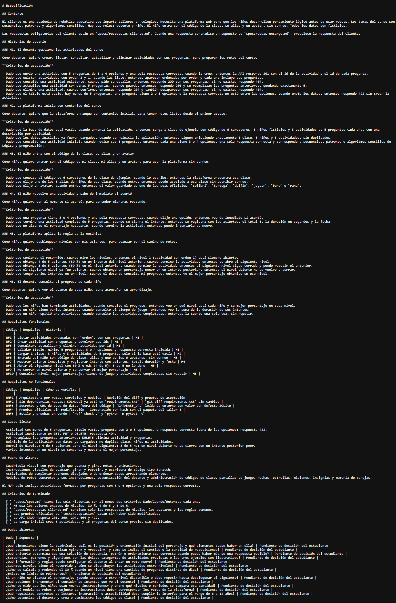

Explicación: sección H5 de `specs/spec.md` con los valores exactos de Niveles: 80 %, 4 de 5 aciertos, 3 de 5, nivel abierto que no se cierra y mejor porcentaje para el docente.

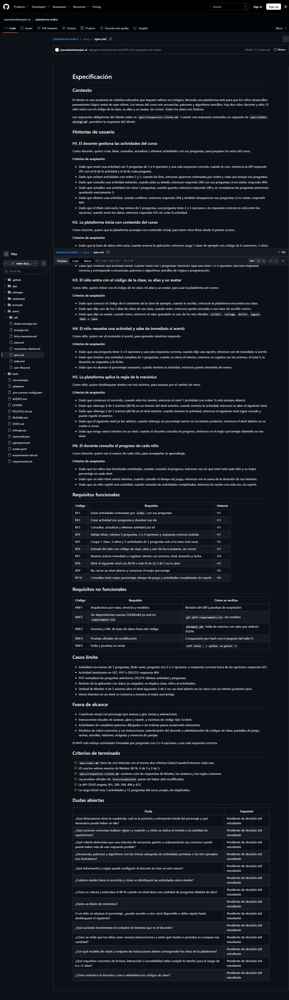

Explicación: la misma historia H5 en GitHub, con la rama `taller-8/actividades` visible en la navegación.

El plan del agente con las seis historias y sus criterios resumidos se presentó antes de escribir `specs/spec.md` y fue aprobado por el desarrollador; el registro completo está en `prompts/taller-8-actividades.md`. Las seis historias tienen 6, 3, 3, 3, 5 y 3 criterios Dado/Cuando/Entonces, respectivamente.

## 3. Modelo de datos

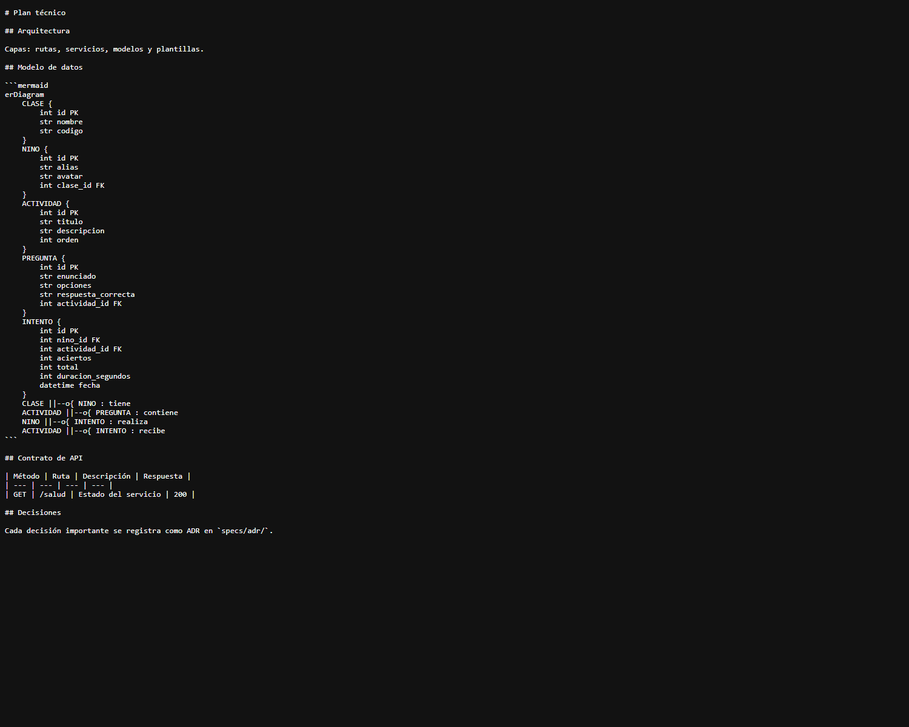

Explicación: el bloque Mermaid `erDiagram` de `specs/plan.md` con las cinco entidades del contrato y sus relaciones.

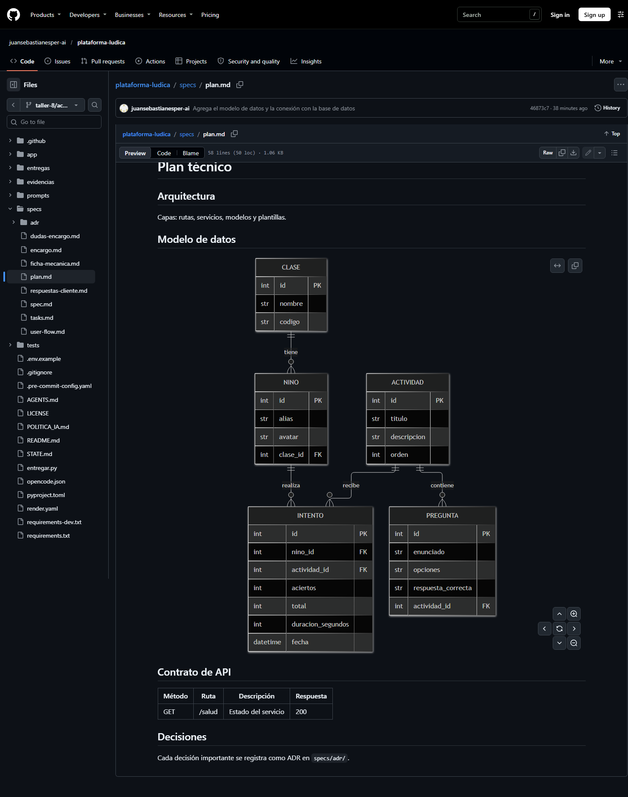

Explicación: GitHub muestra el diagrama entidad-relación renderizado desde la rama `taller-8/actividades`; se aprecian `CLASE`, `NINO`, `ACTIVIDAD`, `PREGUNTA` e `INTENTO`.

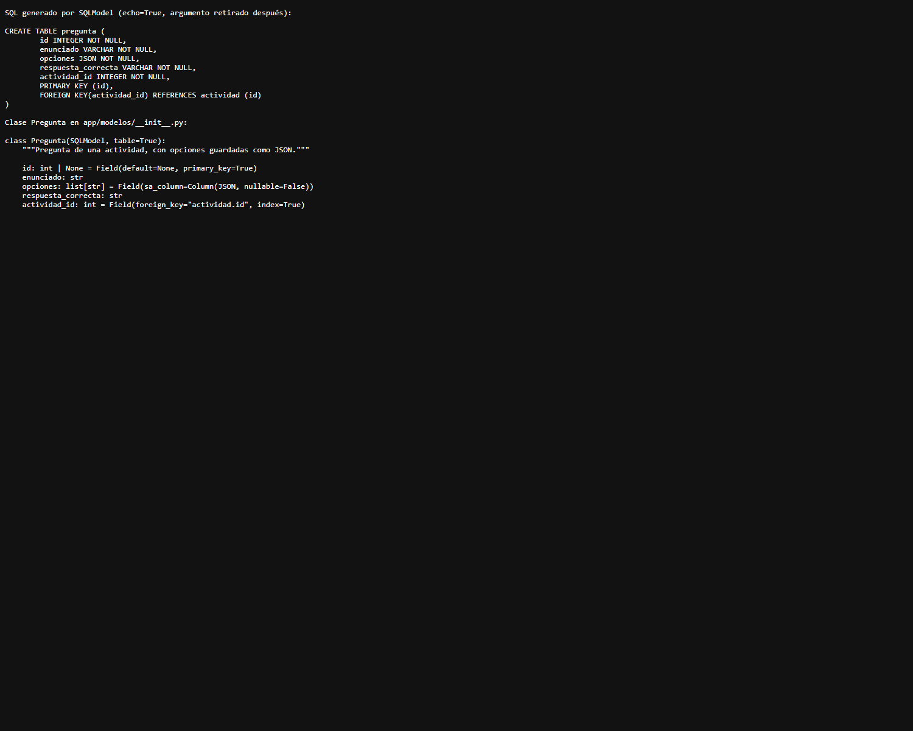

Explicación: sentencia real `CREATE TABLE pregunta` generada por SQLModel con `echo=True` (argumento retirado después), junto a la clase `Pregunta` de `app/modelos/__init__.py`. La columna `opciones` queda como `JSON NOT NULL` y la clave foránea referencia `actividad`.

El plan del agente con las rutas completas de los archivos se presentó antes de escribir código y fue aprobado.

## 4. Pruebas en rojo

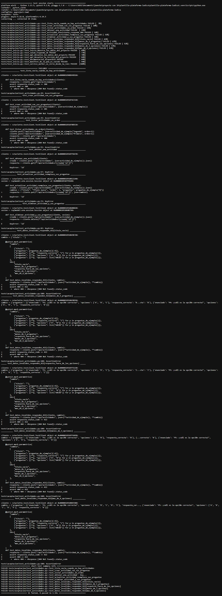

Explicación: `python -m pytest -v` ejecutado después de copiar las pruebas oficiales y antes de implementar la API. Muestra `11 failed, 8 passed`: 11 pruebas rojas y 1 verde en `test_actividades.py`, más las 7 pruebas previas en verde. La primera Fallo es `assert 404 == 200`, porque `/api/actividades` todavía no existía.

## 5. API de actividades

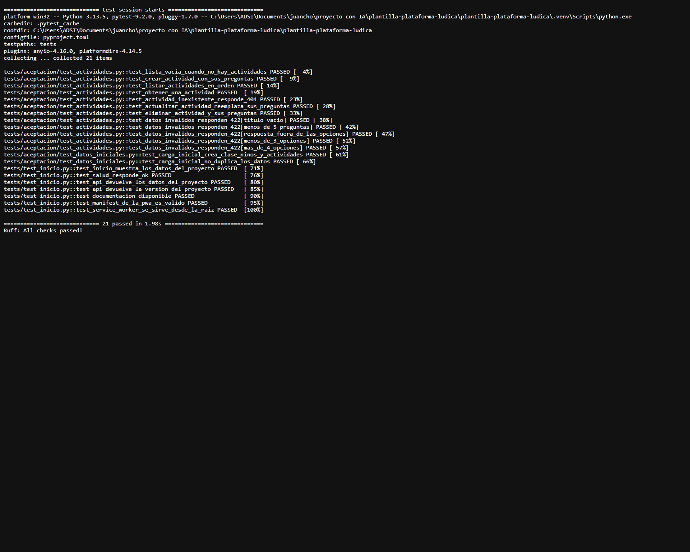

Explicación: `python -m pytest -v` con 19 pruebas en verde y `ruff check .` con `All checks passed!` después de implementar el CRUD. El plan del agente con las rutas completas (`app/esquemas.py`, `app/servicios/actividades.py`, `app/rutas/actividades.py` y `app/main.py`) se aprobó antes de escribir el código.

## 6. Prueba en /docs

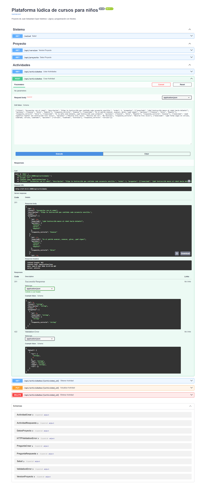

Explicación: Swagger `/docs` con la sección Actividades y cinco operaciones; `POST /api/actividades` se ejecutó con una actividad de Lógica y programación («Secuencias con el robot») y devolvió **201** con el id de la actividad y de cada pregunta. También se comprobó un cuerpo inválido con respuesta 422.

## 7. Contenido inicial

| N.º Pregunta | ¿La respuesta correcta lo es? | ¿El lenguaje es adecuado para niños de 6 a 10 años? | Corrección aplicada |
| --- | --- | --- | --- |
| 1 | Sí | Sí | Ninguna |
| 2 | Sí | Sí | Ninguna |
| 3 | Sí | Sí | Ninguna |
| 4 | Sí | Sí | Ninguna |
| 5 | Sí | Sí | Ninguna |
| 6 | Sí | Sí | Ninguna |
| 7 | Sí | Sí | Ninguna |
| 8 | Sí | Sí | Ninguna |
| 9 | Sí | Sí | Ninguna |
| 10 | Sí | Sí | Ninguna |
| 11 | Sí | Sí | Ninguna |
| 12 | Sí | Sí | Ninguna |
| 13 | Sí | Sí | Ninguna |
| 14 | Sí | Sí | Ninguna |
| 15 | Sí | Sí | Ninguna |

Explicación de la tabla: el desarrollador revisó sin IA las 15 preguntas propuestas, sus opciones y sus respuestas correctas, y aprobó el contenido sin correcciones.

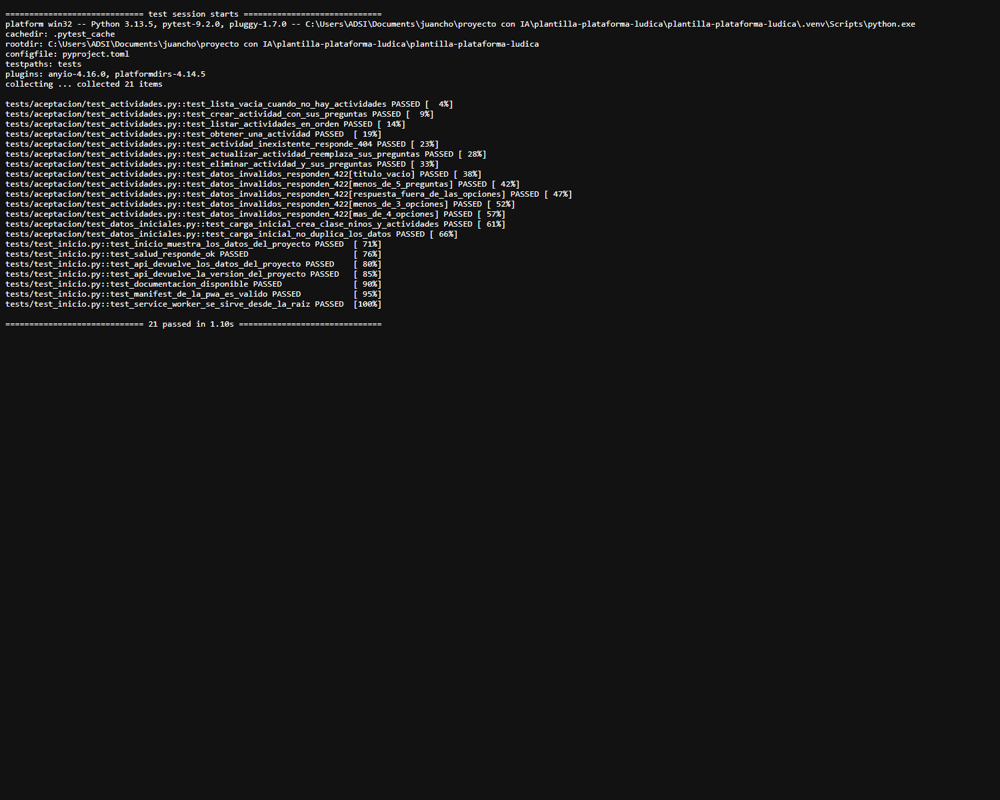

Explicación: `python -m pytest -v` con las 21 pruebas en verde, incluidas las dos de `tests/aceptacion/test_datos_iniciales.py`.

Explicación: `http://127.0.0.1:8000/api/actividades` con formato JSON muestra exactamente 3 actividades de 5 preguntas cada una, del curso Lógica y programación. Tras detener y reiniciar el servidor, la respuesta sigue siendo 3 actividades: la carga es idempotente.

## 8. Lecciones aprendidas

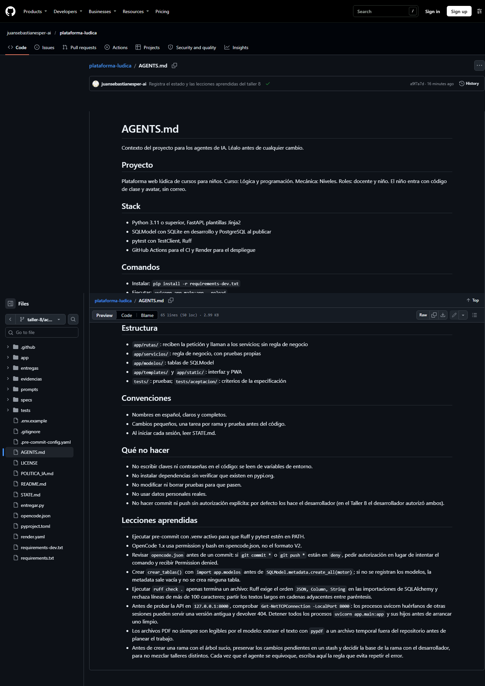

Explicación: sección «Lecciones aprendidas» de `AGENTS.md` en GitHub, en la rama `taller-8/actividades`, con reglas nuevas del taller sobre permisos de git, orden de importaciones, líneas largas, procesos uvicorn huérfanos, lectura de PDF y preservación de cambios pendientes.

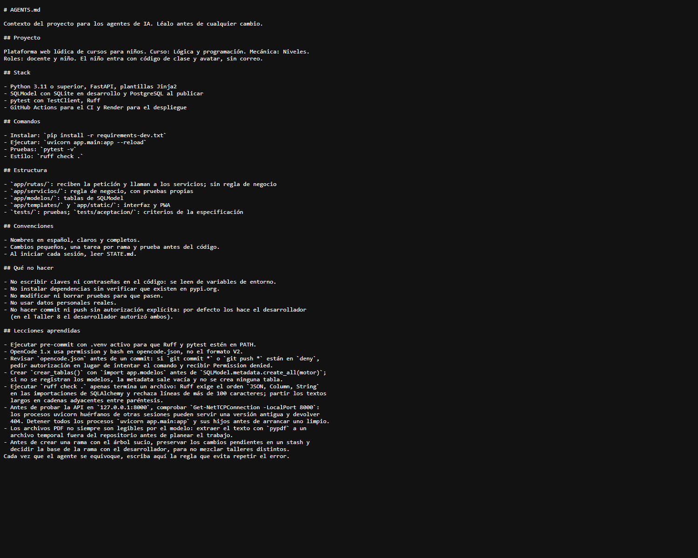

Explicación: la misma sección en el archivo local, para comprobar que el contenido coincide con el publicado.

## 9. Integración y despliegue

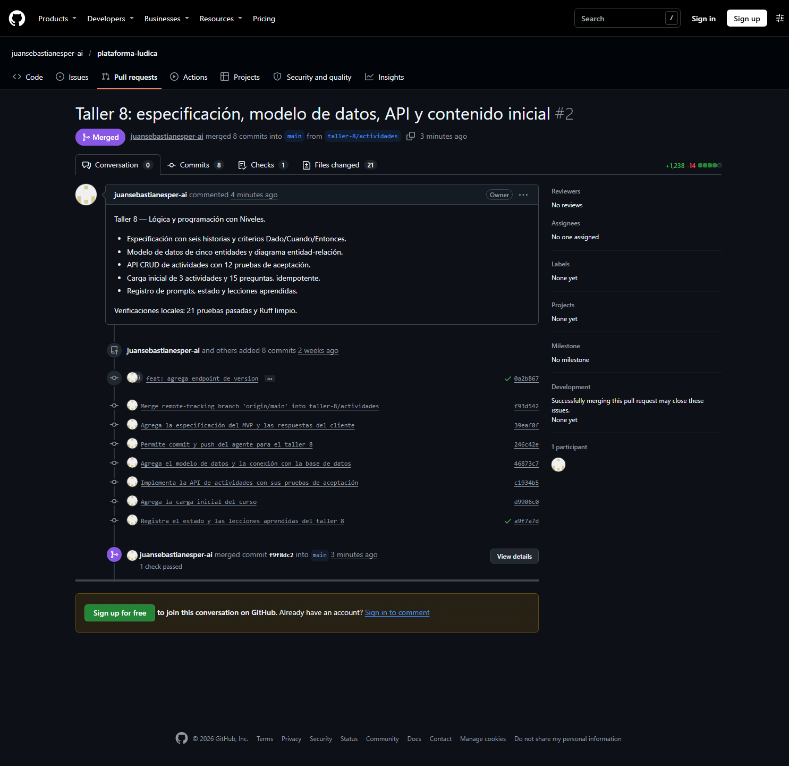

Explicación: pull request #2 de `taller-8/actividades` a `main`, fusionado; el repositorio `juansebastianesper-ai/plataforma-ludica` es visible en la captura.

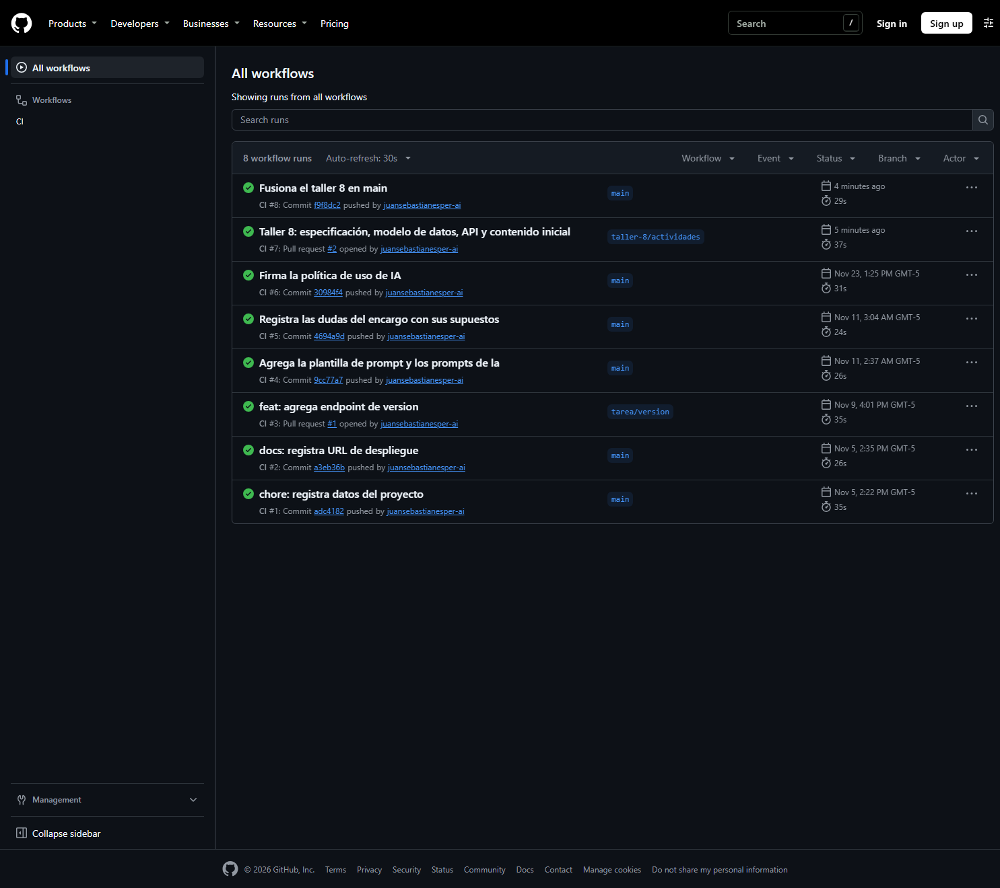

Explicación: la pestaña Actions muestra las ejecuciones de CI completadas correctamente, incluidas la del pull request #2 y la del commit de fusión `f9f8dc2` en `main`. La etiqueta `taller-8` apunta a ese commit.

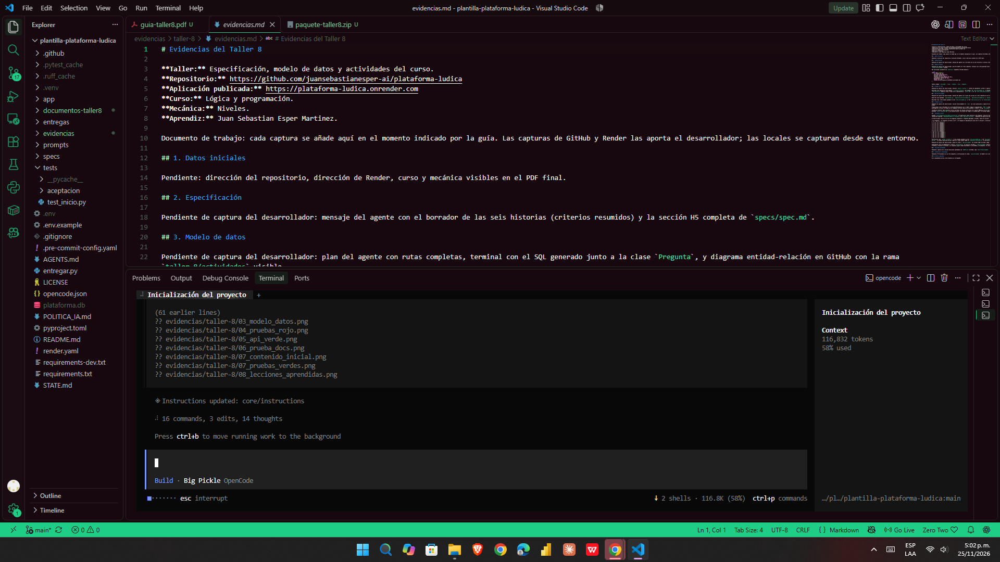

Explicación: navegador con la dirección `https://plataforma-ludica.onrender.com/api/actividades` visible y las 3 actividades del curso propio. No se muestra la pestaña Environment.

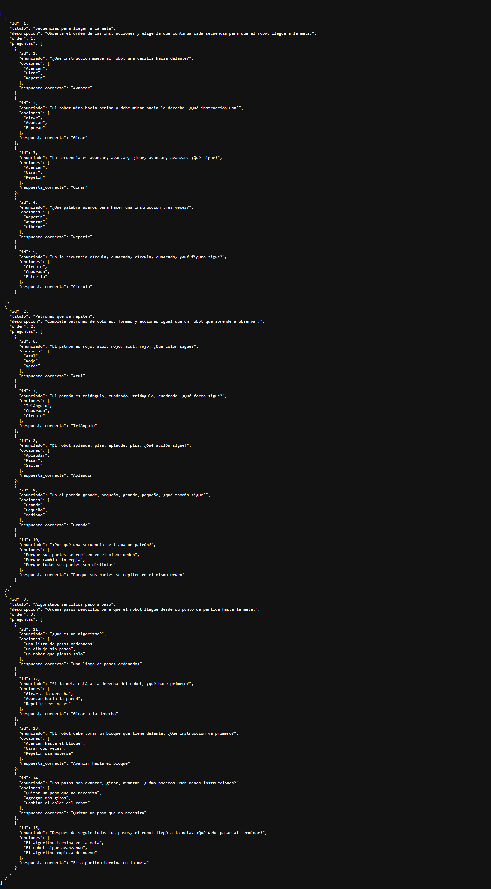

Explicación: detalle con formato JSON de la respuesta de Render, donde se leen los títulos y las preguntas de las tres actividades.

## 10. Extras (opcional)

No se implementaron extras; esta evidencia no corresponde al mínimo obligatorio.
